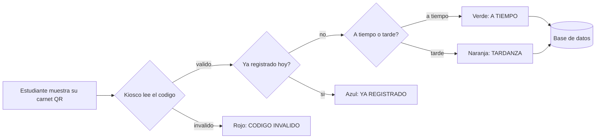

# AsistenciaQR

> Control de asistencia estudiantil por código QR, con clasificación automática de puntualidad.


Proyecto para la Feria de Programación (octubre 2026). Reemplaza la
lista de asistencia en papel: cada estudiante tiene un carnet con un
código QR único, lo muestra en la entrada, y el sistema registra la
hora y decide solo si llegó a tiempo o tarde.

---

## Índice

- [Características](#características)
- [Cómo funciona](#cómo-funciona)
- [Arquitectura](#arquitectura)
- [Base de datos](#base-de-datos)
- [Instalación](#instalación)
- [Primer uso: crear tu cuenta](#primer-uso-crear-tu-cuenta)
- [Roles](#roles)
- [Documentación](#documentación)
- [Equipo](#equipo)

---

## Características

- 📷 **Registro por código QR** — un escaneo, un registro, sin papel.
- ⏰ **Puntualidad automática** — compara la hora contra un horario y
  una tolerancia configurables, sin intervención manual.
- 🆔 **Respaldo manual** — si el carnet falla, se registra con el NIE
  directo en el Kiosco, sin perder el flujo.
- ✍️ **Excepciones documentadas** — registros manuales con motivo y
  nota, para casos que necesitan quedar justificados.
- 🪪 **Carnets con QR propios** — se generan e imprimen desde el
  sistema; el código es un identificador aleatorio, no el NIE.
- 📊 **Dashboard en vivo** — presentes, tardanzas, faltantes y
  porcentaje del día, actualizado en tiempo real.
- 📈 **Reportes filtrables** — por fecha, grado o sección, exportables
  a Excel y PDF.
- 👤 **Roles** — Administrador (acceso total) y Docente (Dashboard,
  Kiosco y Reportes).
- 🔒 **Seguridad por diseño** — contraseñas cifradas (PBKDF2 + sal),
  códigos QR sin datos personales.

## Cómo funciona



## Arquitectura

Separación clásica en tres capas, una carpeta por responsabilidad:

```
Pantallas (Windows Forms)  →  Servicios (reglas de negocio)  →  Repositorios (SQL Server)
```

- **UI/** — componentes reutilizables (botones, tarjetas, barra lateral).
- **Servicios/** — lógica de negocio: `AsistenciaService`,
  `AuthService`, `ConfiguracionHorarioService`, `CarnetService`, etc.
- **Repositorios/** — acceso a datos, un repositorio por tabla.
- **Modelos/** — clases planas que representan cada tabla.

## Base de datos

SQL Server. Tablas principales: `Estudiantes`, `QR`, `Asistencia`,
`Usuarios`, `ConfiguracionHorario`. Los scripts de creación están en
`database/`. Diagrama y diccionario completo en la documentación.

## Instalación

**Requisitos:** Windows, .NET 8, SQL Server (Express sirve), Visual
Studio 2022.

1. Clona el repositorio.
2. Abre `src/AsistenciaQR/AsistenciaQR.sln` en Visual Studio.
3. Clic derecho sobre la solución → **Restaurar paquetes NuGet**
   (necesita internet la primera vez).
4. Corre los scripts de `database/` en tu SQL Server para crear la
   base de datos y las tablas.
5. Abre `src/AsistenciaQR/Repositorios/ConexionSQL.cs` y cambia
   `Server=ANDRES\SQLEXPRESS` por el nombre de **tu propia** instancia
   de SQL Server.
6. Presiona **F5**.

## Primer uso: crear tu cuenta

La base de datos empieza vacía — no hay cuentas por defecto. Para
crear la primera, pega esto justo antes de `ApplicationConfiguration.Initialize();`
en `Program.cs`, corre el proyecto una vez, y bórralo:

```csharp
var authService = new AsistenciaQR.Servicios.AuthService();
var resultado = authService.Registrar("admin", "Administrador", "admin123", "Administrador");
MessageBox.Show(resultado.Mensaje);
```

Cambia usuario/contraseña/rol para crear cuantas cuentas necesites
(usa `"Docente"` como rol para una cuenta de docente).

## Roles

| Rol | Acceso |
|---|---|
| **Administrador** | Las 9 pantallas: Dashboard, Estudiantes, Kiosco, Carnets, Reportes, Excepciones, Configuración, Horarios |
| **Docente** | Dashboard, Kiosco (Asistencia del Día) y Reportes |

## Documentación

- 📘 Manual de Usuario (pantalla por pantalla, con capturas)
- 🧭 Guía de documentación para el equipo
- ✅ Checklist de pruebas núcleo y de interfaz
- 🗂️ Diccionario de datos y diagramas de arquitectura

_(Ver carpeta `docs/` del repositorio.)_

## Equipo

Proyecto de Feria de Programación — [Colegio Salarrue].

| Integrante | 
|Andrés Alexander Marroquín Rodríguez| 
| Antony Leonel Rosa | 
| Mathew Pineda Morales | 
| Aarón Levi Vásquez Moran |
| Alexa Ciefuegos Calderon|  

---

<sub>Los datos de estudiantes usados en pruebas son ficticios.</sub>
