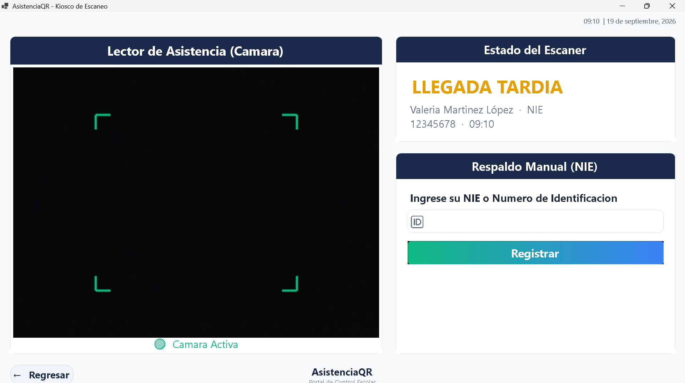
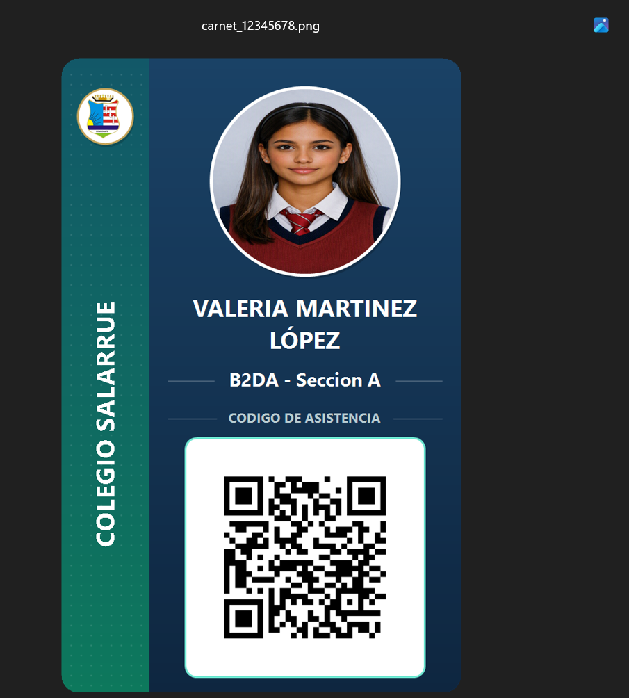
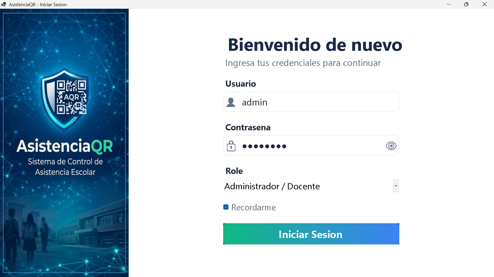
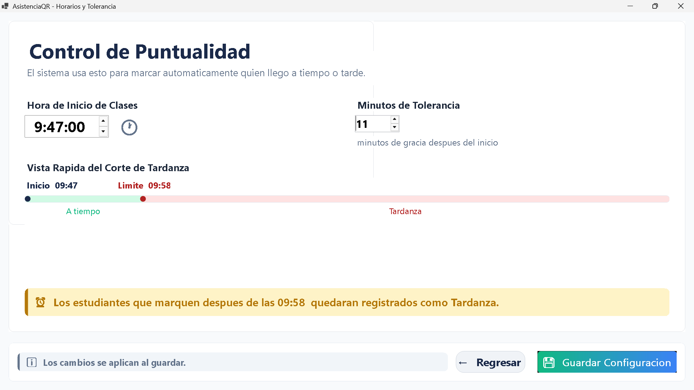
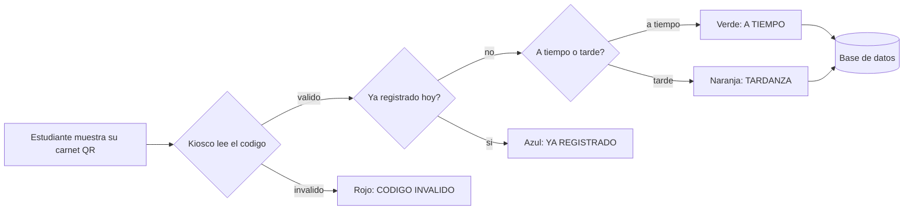
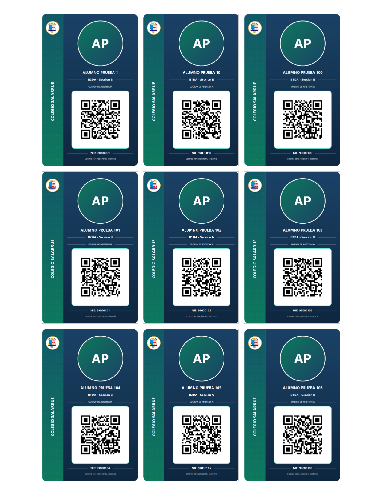

# AsistenciaQR

> Control de asistencia estudiantil por código QR, con clasificación automática de puntualidad.

[](https://github.com/ANDRES242008/sistema-asistencia-qr/actions/workflows/ci.yml)


AsistenciaQR reemplaza la lista de asistencia en papel. Cada estudiante
recibe un carnet con un código QR único; al llegar lo muestra frente a
la cámara del kiosco y el sistema registra la hora y decide solo si
llegó a tiempo o tarde. La dirección ve el resumen del día en vivo y
exporta reportes a Excel o PDF.

El proyecto nació en la Feria de Programación de octubre de 2026 y
sigue en desarrollo.

| Kiosco de escaneo | Carnet generado |
|---|---|
|  |  |
| **Inicio de sesión** | **Horarios y tolerancia** |
|  |  |

---

## Índice

- [Características](#características)
- [Cómo funciona](#cómo-funciona)
- [Tecnologías](#tecnologías)
- [Arquitectura](#arquitectura)
- [Base de datos](#base-de-datos)
- [Instalación](#instalación)
- [Primer uso: crear tu cuenta](#primer-uso-crear-tu-cuenta)
- [Roles](#roles)
- [Pruebas](#pruebas)
- [Documentación](#documentación)
- [Hoja de ruta](#hoja-de-ruta)
- [Autor](#autor)

---

## Características

- 📷 **Registro por código QR**: un escaneo es un registro, sin papel.
- ⏰ **Puntualidad automática**: compara la hora de llegada contra un
  horario y una tolerancia configurables.
- 🆔 **Respaldo manual**: si el carnet falla, se registra con el NIE
  directamente en el kiosco.
- ✍️ **Excepciones documentadas**: registros manuales con motivo y
  observación, para casos que deben quedar justificados.
- 🪪 **Carnets con QR propios**: se generan e imprimen desde el
  sistema. El código es un identificador aleatorio, no el NIE.
- 📥 **Importación desde Excel**: carga a todo el colegio de una vez con
  la plantilla incluida. Una vista previa marca en rojo las filas con
  errores (NIE inválido, repetido o ya registrado) y solo se guardan
  las correctas, todas juntas en una transacción.
- 🖨️ **Carnets en lote**: un solo PDF tamaño carta con 9 carnets por
  hoja, a tamaño real y con guía de corte. Genera el QR a quien no lo
  tiene y respeta los ya entregados.
- 🗄️ **Respaldos**: uno automático al día (se conservan los últimos 7),
  respaldo manual, copia a USB y restauración verificada, que antes
  guarda los datos actuales para poder deshacer.
- 📜 **Bitácora de auditoría**: quién hizo cada acción importante y
  cuándo (asistencias manuales, bajas, cambios de horario, cuentas,
  inicios de sesión fallidos, respaldos), con filtros y exportación a
  Excel. Solo lectura: nadie puede editarla desde el programa.
- 🏫 **Para cualquier institución**: cada colegio configura su nombre,
  logo y color, con vista previa del carnet. Aparecen en carnets,
  reportes y el menú; nada de eso está escrito en el código.
- 📊 **Dashboard en vivo**: presentes, tardanzas, faltantes y
  porcentaje de asistencia del día.
- 📈 **Reportes filtrables**: por fecha, grado o sección, exportables
  a Excel y PDF.
- 👤 **Roles y cuentas**: Administrador (acceso total) y Docente
  (Dashboard, Kiosco y Reportes). El Administrador crea cuentas,
  cambia roles, desactiva usuarios y resetea contraseñas desde la app.
- 🔒 **Seguridad por diseño**: contraseñas con hash PBKDF2-SHA256 y sal
  por usuario, comparación en tiempo constante, bloqueo de 15 minutos
  tras 5 intentos fallidos, contraseñas temporales que se deben cambiar
  al entrar, siempre al menos un Administrador activo, consultas SQL
  parametrizadas y códigos QR sin datos personales.
- 🛡️ **Estabilidad**: los errores inesperados quedan registrados en un
  log en vez de cerrar la aplicación, y solo puede abrirse una
  instancia a la vez para no pelear por la cámara.

## Cómo funciona



## Tecnologías

| Área | Herramienta |
|---|---|
| Lenguaje y plataforma | C# · .NET 8 · Windows Forms |
| Base de datos | SQL Server (`Microsoft.Data.SqlClient`) |
| Cámara | OpenCvSharp4 |
| Lectura de QR | ZXing.Net |
| Generación de QR | QRCoder |
| Exportar a Excel | ClosedXML |
| Exportar a PDF | PDFsharp |

## Arquitectura

Tres capas, una carpeta por responsabilidad:

```
Pantallas (Windows Forms)  →  Servicios (reglas de negocio)  →  Repositorios (SQL Server)
```

| Carpeta | Contenido |
|---|---|
| `UI/` | Componentes visuales reutilizables: botones, tarjetas, barra lateral, paleta de colores. |
| `Servicios/` | Reglas de negocio: `AsistenciaService`, `AuthService`, `ConfiguracionHorarioService`, `CarnetService`, `ReporteService`, `CamaraQRService`, etc. |
| `Repositorios/` | Acceso a datos, un repositorio por tabla. |
| `Modelos/` | Clases planas que representan cada tabla y los resultados de las operaciones. |
| `tests/AsistenciaQR.Tests/` | Pruebas unitarias (xUnit) de las reglas de negocio. |

Las pantallas nunca hablan con la base de datos directamente: piden
todo a un servicio, y solo los repositorios ejecutan SQL.

## Base de datos

SQL Server. Tablas: `Estudiantes`, `QR`, `Asistencia`, `Usuarios` y
`ConfiguracionHorario`. El diccionario de datos y las relaciones están
en [docs/DOCUMENTACION_TABLAS.md](docs/DOCUMENTACION_TABLAS.md).

## Instalación

**Requisitos:** Windows 10/11, [.NET 8 SDK](https://dotnet.microsoft.com/download/dotnet/8.0),
SQL Server (la edición Express sirve), Visual Studio 2022 (17.13 o
superior, por el formato `.slnx`) y una cámara web.

1. Clona el repositorio:
   ```bash
   git clone https://github.com/ANDRES242008/sistema-asistencia-qr.git
   ```
2. Abre `src/AsistenciaQR/AsistenciaQR.slnx` en Visual Studio. Los
   paquetes NuGet se restauran solos al compilar (la primera vez
   necesita internet).
3. Crea la base de datos. Con `sqlcmd` instalado, un solo comando
   ejecuta todos los scripts en orden (cambia la instancia si no es
   `.\SQLEXPRESS`):
   ```bash
   database\instalar_todo.cmd .\SQLEXPRESS
   ```
   También puedes abrirlos en SQL Server Management Studio y
   ejecutarlos uno por uno, en el orden de su número:

   | # | Script | Qué hace |
   |---|---|---|
   | 1 | `001_script_inicial.sql` | Crea la base y las tablas `Estudiantes`, `QR` y `Asistencia` |
   | 2 | `002_qr_rutaimagen.sql` | Agrega la ruta de la imagen QR |
   | 3 | `003_columna_observacion.sql` | Agrega observaciones para excepciones |
   | 4 | `004_tabla_usuarios.sql` | Crea la tabla de usuarios para el login |
   | 5 | `005_horarios_puntualidad.sql` | Crea la configuración de horario y tolerancia |
   | 6 | `006_seguridad_usuarios.sql` | Bloqueo por intentos fallidos y cambio obligatorio de contraseña |
   | 7 | `007_bitacora.sql` | Bitácora de auditoría |
   | 8 | `008_institucion.sql` | Nombre, logo y color de la institución |

   Si actualizas desde una versión anterior, no necesitas correr los
   scripts nuevos: la app aplica sola los cambios pendientes al arrancar.

4. Si tu SQL Server no es la instancia local `.\SQLEXPRESS`, cambia la
   cadena de conexión en `src/AsistenciaQR/appsettings.json`:
   ```json
   { "ConnectionStrings": { "AsistenciaQR": "Server=TU-SERVIDOR\\SQLEXPRESS;Database=AsistenciaQR;Trusted_Connection=True;TrustServerCertificate=True;" } }
   ```
   También puedes definir la variable de entorno `ASISTENCIAQR_CONEXION`,
   que tiene prioridad sobre el archivo. Ya no hace falta tocar el código.
5. Presiona **F5**.

## Primer uso: crear tu cuenta

La base de datos empieza sin cuentas. La primera vez que abres el
programa aparece un asistente de **Configuración inicial** que pide
nombre, usuario y contraseña (mínimo 8 caracteres) para crear la cuenta
de Administrador. Después se abre el inicio de sesión normal.

Si el programa no logra conectarse a SQL Server, te dice exactamente
qué archivo revisar en vez de cerrarse.

## Roles

| Rol | Acceso |
|---|---|
| **Administrador** | Todas las pantallas: Dashboard, Estudiantes, Kiosco, Carnets, Reportes, Excepciones, Configuración, Horarios, Usuarios y Bitácora |
| **Docente** | Dashboard, Kiosco (asistencia del día) y Reportes |

Cualquier usuario puede cambiar su propia contraseña desde el menú
lateral (**Cambiar contraseña**).

### Gestión de usuarios

En **Usuarios**, el Administrador crea las cuentas de los docentes. El
sistema genera una contraseña temporal, la copia al portapapeles y la
muestra una sola vez; el docente debe cambiarla la primera vez que
inicia sesión. Si alguien olvida su contraseña o bloquea su cuenta por
intentos fallidos, el Administrador la resetea de la misma forma.

### Cargar a todo el colegio

1. En **Estudiantes → Importar desde Excel**, descarga la plantilla y
   llénala (o pega ahí la lista que ya tiene el colegio).
2. Elige el archivo: la vista previa muestra en verde las filas listas y
   en rojo las que tienen errores, con el motivo.
3. Presiona **Importar**. Las filas con error se pueden corregir en
   Excel e importar después; las ya cargadas se detectan y no se duplican.
4. En **Carnets y QR → Carnets de la lista (PDF)** se generan todos los
   carnets en un PDF listo para imprimir. Si buscas un grado o nombre
   antes, solo salen los de la lista filtrada.



### Respaldos

En **Configuración → Respaldos**:

- Cada día, al abrir el programa, se crea un respaldo automático en
  `C:\ProgramData\AsistenciaQR\Respaldos`. Se conservan los 7 más
  recientes; los manuales nunca se borran solos.
- **Copiar a USB** guarda una copia fuera de la computadora. Es
  importante: si el disco se daña, los respaldos guardados en él
  también se pierden.
- **Restaurar** acepta un respaldo de la lista o un `.bak` traído de
  otra parte. Antes de reemplazar nada se verifica el archivo, se
  comprueba que sea de AsistenciaQR y se respaldan los datos actuales.
  Funciona aunque el respaldo venga de otra computadora o de una
  versión anterior del programa.

Para respaldar y restaurar, la cuenta de Windows que usa el programa
debe ser administradora de SQL Server (lo es quien lo instaló).

### Datos de la institución

En **Configuración → Institución** se escriben el nombre (como debe
salir en el carnet), el logo o escudo y el color de la banda del
carnet, con una vista previa que se actualiza al momento. Se guardan en
la base de datos: se ven igual en todas las computadoras y viajan con
los respaldos. Mientras no se configuren, el sistema muestra "Mi
Institucion" y un emblema genérico.

En `docs/ejemplos/` está el escudo usado en la demostración de la feria.

### Bitácora

En **Bitácora** (menú lateral, solo Administrador) queda registrado,
con usuario y hora:

| Tema | Acciones |
|---|---|
| Asistencia | Registros manuales (respaldo por NIE y excepciones), con el motivo y si fue tardanza |
| Estudiantes | Altas, ediciones (qué campo cambió y de qué a qué), bajas, reactivaciones, importaciones y QR regenerados |
| Cuentas | Inicios de sesión (también los fallidos), bloqueos, cuentas creadas o editadas, reseteos y cambios de contraseña |
| Sistema | Cambios de horario o tolerancia, respaldos manuales y restauraciones |

Los escaneos de QR no se registran aquí (serían cientos al día); están
en Reportes. Las contraseñas nunca se guardan en la bitácora.

## Pruebas

**Pruebas unitarias (xUnit).** Cubren las reglas de negocio sin
necesitar SQL Server: clasificación de puntualidad, validación de
estudiantes, hash y verificación de contraseñas, bloqueo por intentos
fallidos, protección del último Administrador, lectura de la
configuración, importación desde Excel, distribución de carnets en la
hoja, retención de respaldos, textos de la bitácora, logo y color del
carnet, y exportación a Excel. Se ejecutan en cada push con
GitHub Actions:

```bash
dotnet test tests/AsistenciaQR.Tests
```

**Pruebas de integración.** Recorren el núcleo completo (CRUD de
estudiantes, QR, escaneo, dashboard y reportes) contra la base de datos
real; crean sus propios datos de prueba y los eliminan al terminar:

```bash
dotnet run --project src/AsistenciaQR -- --probar-nucleo
```

El código de salida es `0` si todas las pruebas pasan. Las pruebas
manuales de interfaz están en los checklists de la raíz del repositorio.

## Documentación

- 📘 Manual de usuario: [PDF](docs/Manual_de_Usuario_AsistenciaQR.pdf) · [Word](docs/Manual_de_Usuario_AsistenciaQR.docx)
- 🗂️ [Diccionario de datos](docs/DOCUMENTACION_TABLAS.md)
- 📋 [Historias de usuario](docs/HISTORIAS_USUARIO.md)
- ✅ [Checklist de pruebas del núcleo](CHECKLIST_PRUEBAS_NUCLEO.md)
- 🖥️ [Checklist de pruebas de interfaz](CHECKLIST_PRUEBAS_UI_9_PANTALLAS.md)

## Hoja de ruta

- [x] Cadena de conexión en un archivo de configuración, fuera del código
- [x] Asistente de primer uso para crear el administrador
- [x] Proyecto de pruebas unitarias e integración continua (GitHub Actions)
- [x] Ejecutable listo para descargar en Releases (se genera solo al crear un tag `v*`)
- [x] Gestión de usuarios desde la aplicación, con bloqueo por intentos fallidos
- [x] Importar estudiantes desde Excel y carnets en lote
- [x] Respaldos de la base de datos desde la app
- [x] Bitácora de auditoría
- [x] Personalización por institución (nombre, logo, colores)
- [ ] Instalador con configuración automática de la base de datos
- [ ] Notificaciones a padres de familia por tardanza o ausencia

## Autor

**Andrés Alexander Marroquín Rodríguez**: diseño, desarrollo y
documentación. GitHub: [@ANDRES242008](https://github.com/ANDRES242008)

---

<sub>Los datos de estudiantes usados en pruebas son ficticios.</sub>
